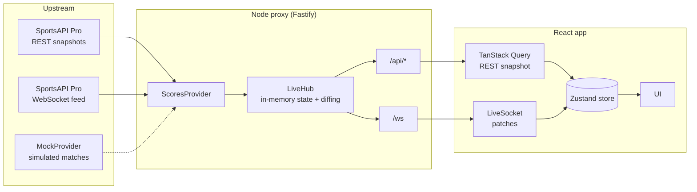

# ⚽ Live Scores

**Today's matches across nine sports, with scores that update in real time — no refresh button.**

A React single-page app backed by a small Node proxy that pulls data from
[SportsAPI Pro](https://sportsapipro.com), keeps it in memory and pushes only what actually changed
to every connected browser over WebSocket. Clone it, run one command, and it works straight away on
realistic simulated data — no API key needed.


---

## ✨ Features

- **Live scores without reloading.** Goals, points, sets and status changes reach the screen
  within seconds, and a changed score briefly flashes so you notice it.
- **Nine sports, five tabs.** Football, Tennis, Basketball and Hockey have their own sections;
  handball, volleyball, baseball, rugby and American football are grouped under _Other_.
- **Live counters in the navigation.** Every sport shows how many matches are in play right now.
- **Organised by competition.** Matches are grouped by league or tournament and sorted with live
  games first, then upcoming, then finished.
- **The detail each sport needs.** Match clock or status (`67′`, `Half-time`, `Set 3`), set-by-set
  tennis scores, and per-period scores for basketball and hockey.
- **"Live only" switch.** Hide everything that isn't being played right now.
- **Honest about the connection.** A badge in the header shows _Connected_, _Reconnecting…_ or
  _Offline – showing last data_ plus the time of the last update; stale live indicators turn grey.
- **Works on any screen.** A sidebar on desktop, scrollable tabs on mobile.
- **Accessible.** WCAG AA contrast, semantic navigation, connection status announced to screen
  readers, and animations that respect `prefers-reduced-motion`.
- **Demo mode out of the box.** Without an API key you get about 20 simulated matches across all
  sports, with a score or status change every 3–8 seconds and a clear "Demo data" banner.

## 🏗️ How it works



**One upstream connection, many browsers.** The server holds a single provider subscription,
keeps today's matches in memory and sends each client only the sport it is looking at. Answering
`/api/matches` never triggers an upstream request, so REST usage stays the same whether one person
or a hundred are watching.

**Only real changes go over the wire.** `MatchState` fingerprints every match (ignoring
timestamps) and emits a `patch` only when something visible changed: score, status, clock or
period scores.

**Built to cope with failure.**

| Situation                            | What happens                                                                                   |
| ------------------------------------ | ---------------------------------------------------------------------------------------------- |
| Invalid or missing API key (401/403) | The server switches to the mock provider at runtime                                            |
| REST quota used up (429)             | REST calls pause until the quota resets; WebSocket updates keep flowing                        |
| Upstream WebSocket drops             | The server reconnects with exponential backoff                                                 |
| Browser loses the socket             | The client reconnects on the same backoff schedule, resubscribes and receives a fresh snapshot |
| Socket silent for 60 s / down 30 s   | The client falls back to REST polling until live updates return                                |
| Tab in the background for 5 min      | The socket is closed to save resources and reopened when you come back                         |
| REST snapshot older than a patch     | The store keeps whichever copy of a match has the newer `updatedAt`                            |

**The API key never leaves the server.** It lives in `server/.env` and is sent upstream in the
`x-api-key` header. In development Vite proxies `/api` and `/ws`, so the browser only ever talks to
the local proxy.

## 🧰 Tech stack

| Layer        | Technologies                                                                          |
| ------------ | ------------------------------------------------------------------------------------- |
| **Frontend** | React 18, Vite 5, Mantine 7, TanStack Query 5, Zustand 5, Tabler Icons, CSS Modules   |
| **Backend**  | Node ≥ 20.12, Fastify 5, `@fastify/websocket`, `ws`, Zod, run through `tsx`           |
| **Shared**   | Typed `Match` model, WebSocket message unions, sorting and grouping helpers           |
| **Dates**    | `date-fns` + `date-fns-tz` (matches are filtered by "today" in your time zone)        |
| **Testing**  | Vitest, Testing Library, jsdom, MSW (REST), mock-socket (WebSocket)                   |
| **Tooling**  | TypeScript strict with `noUncheckedIndexedAccess`, ESLint 9, Prettier, npm workspaces |

## 📁 Project structure

```
live-scores/
├── shared/   # The single data model both sides use: Match, SportCategory, WS messages, helpers
├── server/   # Fastify proxy → http://localhost:8787
│   ├── src/live/        # LiveHub, MatchState diffing, reconnect backoff
│   ├── src/providers/   # ScoresProvider interface, SportsAPI Pro client, MockProvider
│   ├── scripts/         # sample.ts: captures real API responses into fixtures/
│   └── test/
└── web/      # React app → http://localhost:5173
    ├── src/api/         # useLiveScores hook, LiveSocket, REST client
    ├── src/components/  # MatchRow, MatchList, SportNav, ConnectionBadge, …
    ├── src/store/       # Zustand match store
    └── src/theme/       # Colour tokens and Mantine theme
```

`shared` has no build step: it exports its TypeScript source directly, so a change to the model or
the message types is picked up by both the server and the web app immediately.

## 🚀 Getting started

Requires **Node.js 20.12 or newer**.

```bash
npm install
npm run dev
```

Open **http://localhost:5173**. The server starts on port 8787 with simulated data, and the app
is ready to explore.

### Using real data from SportsAPI Pro

```bash
cp server/.env.example server/.env    # set SPORTS_API_KEY and DATA_PROVIDER=sportsapipro
npm run sample -w server              # save real API responses to server/fixtures/
npm run dev
```

> [!WARNING]
> **The SportsAPI Pro mapping has not been checked against real responses yet.** The field names
> for status, clock, set scores, competition and sport id in
> `server/src/providers/sportsApiPro.ts` are educated guesses, marked `ASSUMED`. Run
> `npm run sample -w server` with a key and adjust `GameSchema` / `mapStatus` to the captured
> fixtures before relying on real data. Unknown statuses are always treated as _scheduled_, never
> as live.

## ⚙️ Configuration

All settings live in `server/.env` (git-ignored; copy it from `.env.example`).

| Variable                   | Default                               | Description                                        |
| -------------------------- | ------------------------------------- | -------------------------------------------------- |
| `SPORTS_API_KEY`           | –                                     | Without it the server runs on mock data            |
| `DATA_PROVIDER`            | `mock`                                | `sportsapipro` or `mock`                           |
| `SPORTS_API_BASE`          | `https://v1.{sport}.sportsapipro.com` | `{sport}` is replaced with each sport's slug       |
| `SPORTS_API_WS`            | football host + `/ws`                 | Upstream WebSocket URL                             |
| `PORT`                     | `8787`                                | Proxy port                                         |
| `SNAPSHOT_REFRESH_MINUTES` | `10`                                  | How often REST snapshots refresh (9 requests each) |

> [!TIP]
> **Mind the quota.** The free plan allows 100 REST requests a day. With a 10-minute refresh, nine
> sports use about 54 requests an hour, so the quota runs out in under two hours. After that the
> app keeps running on WebSocket updates alone until the reset. For a demo that runs all day, set
> `SNAPSHOT_REFRESH_MINUTES=120`.

## 🔌 API

| Endpoint                               | Description                                           |
| -------------------------------------- | ----------------------------------------------------- |
| `GET /api/matches?category=&date=&tz=` | Matches for one category on a given day and time zone |
| `GET /api/sports`                      | Total and live match counts per category              |
| `GET /api/health`                      | Active provider, upstream state, remaining quota      |
| `WS /ws`                               | Live updates                                          |

WebSocket messages (types live in `shared/src/messages.ts`):

```ts
// client → server
{ type: 'subscribe', category: 'tennis' }
{ type: 'ping' }                                   // sent every 25 s

// server → client
{ type: 'snapshot', category, matches }            // full list after subscribing
{ type: 'patch', matches, ts }                     // only the matches that changed
{ type: 'counts', counts }                         // live counts for the navigation
{ type: 'status', upstream }                       // 'connected' | 'reconnecting' | 'down'
{ type: 'pong' }
```

## 🧪 Development

| Command                           | What it does                                    |
| --------------------------------- | ----------------------------------------------- |
| `npm run dev`                     | Server and web app with hot reload              |
| `npm test`                        | Vitest in every workspace                       |
| `npm run typecheck`               | `tsc --noEmit` in every workspace               |
| `npm run lint` / `npm run format` | ESLint / Prettier                               |
| `npm run build`                   | Production build of the web app into `web/dist` |
| `npm run sample -w server`        | Capture real API responses (needs a key)        |

Run a single test file or a single test:

```bash
npm test -w server -- test/live.test.ts
npm test -w web -- src/components/MatchRow.test.tsx -t "flash"
```

The tests cover the REST routes (through Fastify's `inject`), LiveHub diffing and fan-out, the
SportsAPI Pro mapping, the sorting helpers, the match list and row components, and the full
live-update flow in the browser hook with mocked REST and WebSocket.

## 🎨 Design notes

- A calm forest-green and cream palette, defined as CSS variables in `web/src/theme/tokens.css`
  and as the Mantine `forest` palette. Components never hard-code colours.
- Muted text uses `#5C6B61` (4.9:1 on cream) to meet WCAG AA. The lighter `green-500` (3.8:1)
  is used only for accents, borders and icons, never for body text.
- Hockey uses Tabler's `IconIceSkating`, because Tabler has no hockey icon.

## Deploy (Render)

GitHub Pages serves static files only, so it cannot run the proxy (REST + WebSocket + hidden API key).
`render.yaml` defines a single Render web service instead: the build runs `npm ci && npm run build`, and
the server serves `web/dist` together with `/api` and `/ws` from one origin.

1. Push the repo to GitHub, then in Render choose **New → Blueprint** and pick the repo.
2. Enter `SPORTS_API_KEY` when prompted (leave empty to run on mock data) and set `DATA_PROVIDER=sportsapipro`
   to use the real API.
3. The free plan sleeps after inactivity; the first request then takes a while to wake it.
