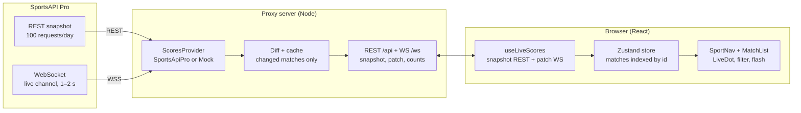

# Technical Specification: Live Scores (React)

_As of 2026-10-24_

## 1. Goal and scope

We are building a test web application in React that shows today's sports results from an external API and updates them live over WebSocket. It is a demo project: it runs locally, on the API's free plan, with no user accounts and no database.

**In scope:** a sports list in the sidebar (Football, Tennis, Basketball, Hockey, Other), a list of today's matches, a glowing dot marking matches in progress, score updates without page reload, and a theme in shades of green and cream white.

**Out of scope (v1):** user accounts, favourite teams, push notifications, match details (lineups, stats), betting and odds, native mobile apps. The layout must still be responsive.

This document is meant to be placed in the repository as `SPEC.md` and implemented step by step following section 9.

## 2. Functional requirements

| ID  | Requirement            | Details                                                                                                                                                                                     |
| --- | ---------------------- | ------------------------------------------------------------------------------------------------------------------------------------------------------------------------------------------- |
| F1  | Sports sidebar         | Items: Football, Tennis, Basketball, Hockey, Other. Each shows a live-match count (e.g. "3 live"). Active item highlighted. Football selected by default.                                   |
| F2  | "Other" category       | Aggregates the remaining API sports: handball, volleyball, baseball, rugby, American football. Matches grouped under a header per sport.                                                    |
| F3  | Today's matches list   | Matches for the current day in the browser's time zone (default Europe/Warsaw). Grouped by competition (league/tournament); sorted live first, then scheduled by start time, finished last. |
| F4  | Match row              | Home team, away team, score (or kick-off time for scheduled matches), status (e.g. "67′", "Q2", "Set 3", "Half-time", "FT"). Tennis: score by sets.                                         |
| F5  | Live indicator         | A match in progress shows a glowing, pulsing green dot on the left. Scheduled and finished matches do not. Animation disabled under `prefers-reduced-motion`.                               |
| F6  | Live updates           | Scores and statuses update without a page reload (WebSocket, section 7). A changed score briefly highlights (flash of about 1.5 s).                                                         |
| F7  | "Live only" filter     | Toggle above the list that hides matches not in progress.                                                                                                                                   |
| F8  | Connection state       | Header indicator: Connected / Reconnecting / Offline (showing last data) + time of the last update.                                                                                         |
| F9  | Empty and error states | Messages for: no matches today, no live matches, API error, rate limit exceeded. Skeleton placeholders on first load.                                                                       |
| F10 | Responsiveness         | From 1024 px the sidebar is fixed; below that it collapses into a horizontal tab bar above the list.                                                                                        |

## 3. Data source: choosing the API

Recommendation: **SportsAPI Pro (V1)** as the primary source, because it is one of the few that offers WebSocket on the free plan and covers all four required sports with a single key. The app must also run on a **mock** from day one (no key needed), and the provider is swappable through an adapter (section 6).

| Provider                                                                                                                              | Sports from the list                                  | Live push                      | Free plan                                                                | Notes                                                                  |
| ------------------------------------------------------------------------------------------------------------------------------------- | ----------------------------------------------------- | ------------------------------ | ------------------------------------------------------------------------ | ---------------------------------------------------------------------- |
| [SportsAPI Pro V1](https://docs.sportsapipro.com/api-reference/v1-legacy/overview) (recommended)                                      | football, tennis, basketball, hockey + 5 others       | WebSocket, updates every 1–2 s | 100 REST requests/day; WebSocket traffic does not count toward the quota | Key in the `x-api-key` header or in the WebSocket URL parameter        |
| [API-Football / API-Sports](https://www.api-football.com/news/post/how-to-get-started-with-api-football-the-complete-beginners-guide) | football, basketball, hockey (separate API per sport) | none, REST only (polling)      | 100 requests/day per API                                                 | Polling live every 15 s exhausts the free quota within tens of minutes |
| Local mock                                                                                                                            | all                                                   | simulated WebSocket            | unlimited                                                                | For development, tests and offline demos                               |

**Confirmed facts about SportsAPI Pro (as of October 2026):**

- REST base URL: `https://v1.{sport}.sportsapipro.com`, where `{sport}` ∈ `football`, `basketball`, `tennis`, `hockey`, `handball`, `american-football`, `baseball`, `volleyball`, `rugby`. The docs also show the variant `https://api.sportsapipro.com/v1/{sport}`; keep the base URL in configuration.
- Endpoints used by the app: `GET /api/v1/{sport}/live` (matches in progress), `GET /games/current` (current/today's). Responses use the envelope `{ success, type, cacheHit, sport, data: { games, competitions, countries } }` plus a `ttl` field (about 5 s for live).
- WebSocket: `wss://v1.{sport}.sportsapipro.com/ws?x-api-key=KEY`. On connect the server sends `{type:"connected"}` with the channel list. The client sends `{type:"subscribe", channel:"live"}` (channels: `all`, `live`, a sport slug, `match:{id}`). The server replies with `{type:"scores", channel, games[], updateId, ts}`. `ping`/`pong` is supported.
- A match object includes `homeCompetitor` and `awayCompetitor` with `name` and `score` fields. Other fields (status, minute, sets, start time) must be confirmed against a real response — task 0 in section 9.
- Limits: 429 `RATE_LIMIT_EXCEEDED` once the daily quota is used up; headers `X-RateLimit-Limit`, `X-RateLimit-Remaining`, `X-RateLimit-Reset` (reset at midnight UTC).

**Architectural consequence:** REST only for the initial snapshot (a few requests per session); all updates via WebSocket. The API key never goes to the browser — a small proxy server holds it (section 5).

## 4. Tech stack

A monorepo with packages `web` (React), `server` (Node proxy) and `shared` (types). Mantine is proposed instead of Foundation — it ships ready components (AppShell, NavLink, Badge, Skeleton, Switch) and is easy to theme with a custom green palette; Foundation for Sites is not actively developed for React.

| Layer           | Choice                                            | Rationale                                                                |
| --------------- | ------------------------------------------------- | ------------------------------------------------------------------------ |
| Build           | Vite + TypeScript (strict)                        | Fast dev server, WebSocket proxy in config                               |
| UI              | React 18+, Mantine 7                              | Components and theming; alternative: plain CSS Modules                   |
| Server state    | TanStack Query                                    | REST snapshot, caching, loading and error states                         |
| Live state      | Zustand (match store)                             | Frequent, targeted WebSocket updates without re-rendering the whole list |
| Data validation | Zod                                               | Parsing provider responses in the adapter                                |
| Dates           | date-fns + date-fns-tz                            | "Today" in the browser's time zone                                       |
| Proxy           | Node 20, Fastify + `@fastify/websocket` (or `ws`) | Hides the API key, one upstream connection, fan-out to clients           |
| Testing         | Vitest, React Testing Library, MSW, `mock-socket` | Unit tests for adapters and components, REST and WS mocks                |
| Quality         | ESLint, Prettier                                  | Consistent generated code                                                |

Environment variables (only in `server/.env`, which is in `.gitignore`): `SPORTS_API_KEY`, `SPORTS_API_BASE` (default `https://v1.{sport}.sportsapipro.com`), `DATA_PROVIDER` = `sportsapipro` or `mock`, `PORT` (default 8787). Without a key the server starts in `mock` mode.

## 5. Architecture and project structure

The browser talks only to our own proxy server; the proxy holds the API key, keeps a single connection to the provider and sends clients only the matches that changed.



The API key lives only in `server/.env`; the browser connects only to the proxy. Swapping `SportsApiPro` for `Mock` changes nothing on the browser side.

```text
live-scores/
├─ package.json            # npm workspaces, dev script (concurrently)
├─ SPEC.md                 # this document
├─ shared/src/             # Match, SportCategory, WS message types
├─ server/
│  ├─ src/index.ts         # Fastify: /api, /ws, /api/health
│  ├─ src/providers/       # ScoresProvider, sportsApiPro.ts, mock.ts
│  ├─ src/live/            # upstream WS, diff, broadcast, backoff
│  ├─ scripts/sample.ts    # task 0: capture real API responses
│  └─ fixtures/            # saved API responses for tests
└─ web/
   ├─ vite.config.ts       # proxy /api and /ws → localhost:8787
   └─ src/
      ├─ theme/            # colour tokens, Mantine theme
      ├─ api/              # REST client, useLiveScores
      ├─ store/            # Zustand
      ├─ components/       # SportNav, MatchRow, LiveDot, …
      └─ App.tsx
```

## 6. Data model and adapters

The frontend knows only the normalised model from the `shared` package; the provider's data shape exists only in the server-side adapter. Switching APIs therefore means a new adapter, with no UI changes.

```ts
export type SportCategory = 'football' | 'tennis' | 'basketball' | 'hockey' | 'other';
export type MatchStatus = 'scheduled' | 'live' | 'break' | 'finished' | 'postponed' | 'cancelled';

export interface Match {
  id: string; // `${provider}:${sport}:${providerId}`
  sport: string; // provider slug, e.g. 'handball'
  category: SportCategory; // maps to a sidebar item
  competition: { id: string; name: string; country?: string };
  home: { name: string; score: number | null; logoUrl?: string };
  away: { name: string; score: number | null; logoUrl?: string };
  periodScores?: { home: number; away: number }[]; // tennis sets, quarters, periods
  status: MatchStatus;
  statusLabel: string; // e.g. "67′", "Set 3", "Half-time"
  startTime: string; // ISO 8601 UTC
  updatedAt: number; // ts of the last message
}

export const isLive = (m: Match) => m.status === 'live' || m.status === 'break';
```

**Provider interface (server):**

```ts
export interface ScoresProvider {
  getToday(sport: string): Promise<Match[]>; // REST snapshot
  subscribe(onUpdate: (matches: Match[]) => void): () => void; // live, returns unsubscribe
}
```

Implementations: `SportsApiProProvider` (REST + one upstream WS connection on the `live` channel), `MockProvider` (generates about 20 matches per day and randomly changes a score or status every 3–8 s).

**Category mapping:** `football → football`, `tennis → tennis`, `basketball → basketball`, `hockey → hockey`; `handball`, `volleyball`, `baseball`, `rugby`, `american-football → other`.

**Status mapping:** in the adapter, via a Zod schema; unknown status values are logged and treated as `scheduled`, so a match is never falsely shown as live.

## 7. Live updates

Decision: WebSocket end to end — upstream from the provider to the proxy, and our own WebSocket from the proxy to the browser. REST polling stays only as an emergency fallback, because 100 requests a day cannot sustain continuous refresh.

**Proxy REST contract:**

- `GET /api/sports` → category list with counts `{ category, total, live }`.
- `GET /api/matches?category=football&date=YYYY-MM-DD` → `Match[]`. The server caches a per-sport snapshot in memory (60 s TTL for scheduled/finished) to save the daily quota.
- `GET /api/health` → `{ provider, upstream: 'connected' | 'reconnecting' | 'down', rateLimitRemaining }`.

**Proxy WebSocket contract** (`/ws`; Vite proxies `/ws` and `/api` to port 8787):

| Direction       | Message                                                  | Meaning                                                                      |
| --------------- | -------------------------------------------------------- | ---------------------------------------------------------------------------- |
| client → server | `{ "type": "subscribe", "category": "football" }`        | Subscribe to the category shown in the UI; switching tabs = new subscription |
| client → server | `{ "type": "ping" }`                                     | Heartbeat every 25 s                                                         |
| server → client | `{ "type": "snapshot", "category", "matches": Match[] }` | Full state after subscribing                                                 |
| server → client | `{ "type": "patch", "matches": Match[], "ts" }`          | Changed matches only (server-side diff)                                      |
| server → client | `{ "type": "counts", "counts": { football: 3, … } }`     | Live counts for the sidebar                                                  |
| server → client | `{ "type": "status", "upstream": "reconnecting" }`       | Provider connection state                                                    |
| server → client | `{ "type": "pong" }`                                     | Heartbeat reply                                                              |

**Server rules:**

1. One upstream connection regardless of client count; subscribe to the `live` channel (all sports) plus a REST snapshot of today's matches at startup and every 10 min.
2. Each `scores` message goes through the adapter → compared with the previous state → only changes go to clients.
3. Upstream drops → reconnect with exponential backoff (1, 2, 4… max 30 s, with jitter) and broadcast `status`.

**Client rules:**

1. Hook `useLiveScores(category)`: snapshot via TanStack Query, then `patch` messages merged into the Zustand store by `id`.
2. Reconnect as above; after reconnecting the client always receives a fresh `snapshot`.
3. No message for 60 s, or a dropped connection for more than 30 s → fall back to polling `GET /api/matches` every 60 s until WebSocket is back.
4. Browser tab in the background (`visibilitychange`) → close the WebSocket after 5 min, reopen on return.

## 8. UI/UX and theme

Layout: header ("Live Scores" logo, today's date, connection indicator) · 240 px sidebar in dark green · main area on a cream background with competition cards. Colours are defined as tokens (CSS variables + Mantine palette `primaryColor: 'forest'`), never hard-coded in components.

| Token               | Value     | Usage                                  |
| ------------------- | --------- | -------------------------------------- |
| `--color-cream-50`  | `#FBF8F1` | App background                         |
| `--color-cream-100` | `#F4EFE3` | Competition card background, row hover |
| `--color-cream-300` | `#E4DCC8` | Borders, dividers                      |
| `--color-green-900` | `#163B2A` | Sidebar, heading text                  |
| `--color-green-700` | `#24573F` | Active sidebar item, buttons           |
| `--color-green-500` | `#3E8E5E` | Accents, links, live count             |
| `--color-green-200` | `#CFE6D6` | Flash background after a score change  |
| `--color-live`      | `#3DDC84` | Glowing live dot                       |
| `--color-text`      | `#1F2A24` | Body text                              |
| `--color-muted`     | `#6B7A70` | Times, finished-match statuses         |
| `--color-danger`    | `#B5483B` | Errors, offline state                  |

Text-to-background contrast ≥ 4.5:1 (WCAG AA) — sidebar text in `cream-50`.

**Live indicator (`LiveDot` component):** a 10 px dot in `--color-live` with a pulsing glow; `aria-label="Match in progress"`; under `prefers-reduced-motion` no animation, only a static glow.

```css
.live-dot {
  width: 10px;
  height: 10px;
  border-radius: 50%;
  background: var(--color-live);
  box-shadow: 0 0 0 0 rgba(61, 220, 132, 0.7);
  animation: live-pulse 1.6s ease-out infinite;
}
@keyframes live-pulse {
  0% {
    box-shadow: 0 0 0 0 rgba(61, 220, 132, 0.7);
  }
  70% {
    box-shadow: 0 0 0 8px rgba(61, 220, 132, 0);
  }
  100% {
    box-shadow: 0 0 0 0 rgba(61, 220, 132, 0);
  }
}
@media (prefers-reduced-motion: reduce) {
  .live-dot {
    animation: none;
    box-shadow: 0 0 6px 2px rgba(61, 220, 132, 0.6);
  }
}
```

**Components:** `AppShell` · `SportNav` (items with icon and live count) · `ConnectionBadge` · `LiveOnlyToggle` · `CompetitionGroup` (league header + list) · `MatchRow` (LiveDot, teams, score, status; score in `font-variant-numeric: tabular-nums`) · `TennisScore` (sets) · `EmptyState`, `ErrorState`, `MatchListSkeleton`.

**Typography:** Inter (UI), weight 600 for scores; 15 px base size. Sport icons: Tabler Icons (bundled with Mantine).

## 9. Errors, tests, acceptance and implementation plan

**Error handling:**

- 401/403 from the provider → the server logs the error, switches to `mock` mode and reports `provider: 'mock'` in `/api/health`; the UI shows a "Demo data" banner.
- 429 → the server stops sending REST requests until `X-RateLimit-Reset` and keeps relaying WebSocket data; the UI shows the rate-limit notice only when there is no data.
- Invalid data shape (Zod) → reject that single match, log a sample payload; the rest of the list keeps working.
- Client offline → the last data stays visible, indicator shows "Offline", LiveDots fade to grey.

**Tests (minimum):**

- `SportsApiProProvider` adapter: category and status mapping, tennis set scores — on fixtures captured from the real API (`server/fixtures/*.json`).
- Server diff: a score change produces a `patch` with one match; no change produces no message.
- `useLiveScores`: merging `patch`, reconnecting, falling back to polling (with `mock-socket`).
- `MatchRow`: LiveDot only for `live`/`break`, flash after a score change.
- Sorting and the "Live only" filter.

**Acceptance criteria:**

- [ ] `npm run dev` in the root starts web (5173) and server (8787); without a key the app runs on the mock.
- [ ] With a SportsAPI Pro key, today's matches appear for all 5 sidebar items.
- [ ] Matches in progress have a pulsing green dot; finished and scheduled ones do not.
- [ ] A score change appears in the UI within ≤ 5 s of the upstream message, without a page reload.
- [ ] The API key never appears in frontend code or in browser network traffic.
- [ ] One user session uses no more than about 15 REST requests per hour.
- [ ] Network drop → "Reconnecting" state; once back, data updates on its own.
- [ ] Lighthouse Accessibility ≥ 90; animation respects `prefers-reduced-motion`.

**Implementation plan** (each stage as a separate prompt, commit after tests pass):

1. Task 0 — script `server/scripts/sample.ts`: fetch `/live` and `/games/current` for the 4 sports plus 30 s of WebSocket traffic, save to `server/fixtures/`. Use them to finalise the Zod schemas (status, minute, sets, start time).
2. Monorepo skeleton (npm workspaces: `web`, `server`, `shared`), TypeScript, ESLint, Vite proxy.
3. `shared` model + `MockProvider` + REST/WS server on the mock.
4. Frontend: AppShell, theme, SportNav, match list, LiveDot — on mock data.
5. `useLiveScores` with WebSocket, change flash, connection indicator, polling fallback.
6. `SportsApiProProvider` (REST + upstream WS) with fixture-based tests.
7. Error states, responsiveness, accessibility, README with run instructions.

Suggested first prompt: _"Read SPEC.md. Implement only stages 1 and 2 from section 9. Before writing code, show me the file plan."_

## Sources

Checked 24 Oct 2026:

- [SportsAPI Pro — V1 overview](https://docs.sportsapipro.com/api-reference/v1-legacy/overview)
- [SportsAPI Pro — V1 WebSocket](https://docs.sportsapipro.com/api-reference/v1-legacy/websocket.md)
- [SportsAPI Pro — Rate limits](https://docs.sportsapipro.com/rate-limits.md)
- [API-Football — getting started](https://www.api-football.com/news/post/how-to-get-started-with-api-football-the-complete-beginners-guide)
